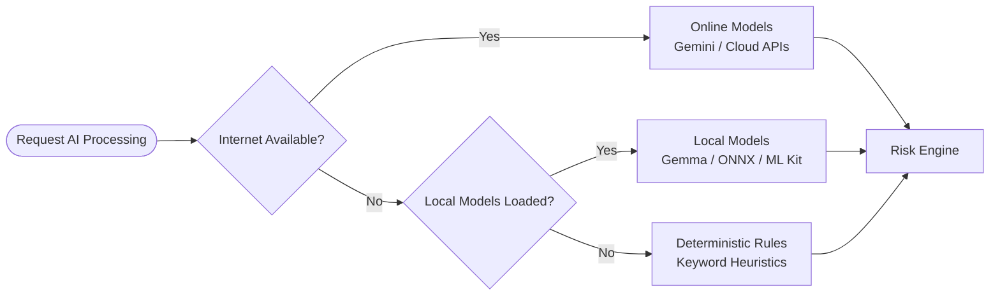

# Thelix AI - System Architecture

## 1. High-Level Architecture
This architecture strictly enforces a layered separation of concerns. The Flutter application (Presentation) communicates only with the Backend APIs. The Backend communicates with the AI ecosystem strictly through the AI Gateway.

```mermaid
graph TD
    %% User & App Layer
    User((User)) --> FlutterApp[Flutter App<br/>(Sujith)]
    FlutterApp -->|HTTPS / JWT| BackendAPI[Backend APIs<br/>(Tharika)]

    %% Backend Layer
    subgraph Backend [Backend Infrastructure]
        BackendAPI --> DB[(Supabase / PostgreSQL)]
        BackendAPI --> AIGateway[AI Gateway<br/>(You)]
    end

    %% AI Subsystem
    subgraph AISubsystem [AI Subsystem]
        AIGateway --> AIOrchestrator[AI Orchestrator]
        
        AIOrchestrator --> OCR[OCR Service]
        AIOrchestrator --> URLIntel[URL Intelligence]
        AIOrchestrator --> QRSense[QR Intelligence]
        AIOrchestrator --> ScamNLP[Scam NLP / Gemma]
        AIOrchestrator --> Deepfake[Deepfake Detection]
        
        OCR --> RiskEngine[Risk Engine]
        URLIntel --> RiskEngine
        QRSense --> RiskEngine
        ScamNLP --> RiskEngine
        Deepfake --> RiskEngine
        
        RiskEngine --> AIGateway
    end
```

## 2. Request Flow (e.g., Screenshot Analysis)
1. **Flutter App** captures a screenshot.
2. **Flutter App** POSTs the image to `/v1/reports/screenshot` (Backend).
3. **Backend** validates the JWT and payload, then POSTs to `/v1/ai/analyze-screenshot` (AI Gateway).
4. **AI Gateway** routes the request to the **AI Orchestrator**.
5. **AI Orchestrator** parallelizes sub-tasks:
   - Calls **OCR Service** to extract text.
   - Passes extracted text to **Scam NLP Service**.
   - Extracts URLs from OCR and calls **URL Intelligence**.
6. **AI Orchestrator** collects all evidence and passes it to the **Risk Engine**.
7. **Risk Engine** computes the Trust Score (0-100) based on deterministic weights.
8. **Risk Engine** uses Gemini (or Gemma if offline) to generate a human-readable explanation of the score.
9. **Risk Engine** returns standardized JSON to the **Backend**.
10. **Backend** saves the record to the DB and returns the JSON to the **Flutter App**.

## 3. Offline vs. Online Fallback Strategy
To ensure the app never fails purely due to connectivity loss:


